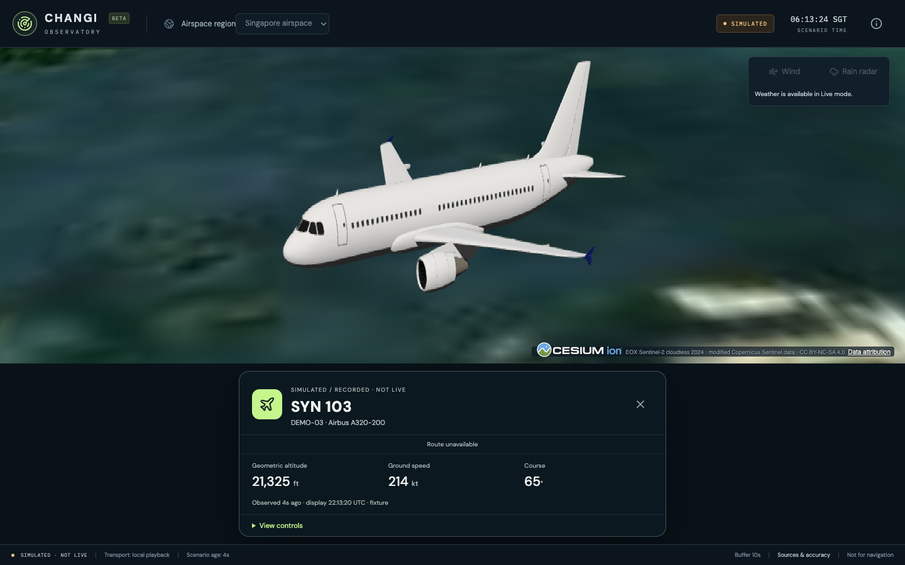

# Changi Observatory

Track aircraft around Singapore Changi on a Cesium map. Select a flight to inspect its last reported position, altitude, and trail, or follow it in 3D.

[Open the tracker](https://perryong.github.io/sg-real-time-flights/). Choose **Live** for received aircraft reports or **Demo** to explore 16 simulated flights.



In **Demo**, select **SYN 103** and choose **Follow aircraft** to see the A320. The tracker scales and centers the mesh for the follow camera. [Airbus A320-200 by Airbus5717](https://sketchfab.com/3d-models/airbus-a320-200-7b8910d3cf824e6399c4ca75a31130ed) · [CC BY-NC 4.0](https://creativecommons.org/licenses/by-nc/4.0/)

## Run locally

Run these commands from the repository root with Python 3.13 and Node.js 26.

```sh
python3.13 -m venv .venv
.venv/bin/python -m pip install -r backend/requirements.lock
(cd frontend && npm ci)
./scripts/dev.sh
```

Open [the local tracker](http://127.0.0.1:5177/) and choose **Demo**. The demo needs no provider credentials. Local live polling starts only after you enable it for personal, non-commercial use. [Configure live feeds](docs/tracker-reference.md#live-configuration)

## Data and limits

Live positions come from ADSB.fi and, when enabled, FlyItalyADSB. Receiver coverage varies, especially on the ground. Route labels use historical callsign data. Runway geometry and flight phases are estimates. For exploration only. Do not use the tracker for navigation or operational decisions.

- [Tracker reference](docs/tracker-reference.md) covers provider terms, weather layers, hosting, tests, and troubleshooting.
- [Map and data credits](assets/LICENSES.md) and [aircraft model credits](data/models/ATTRIBUTION.md) list sources, licenses, and modifications.
