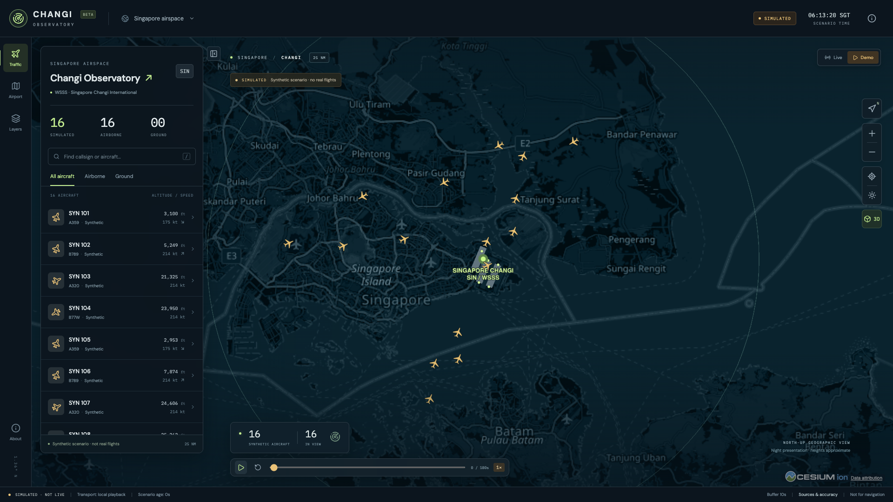

# Changi Observatory

A geographic Singapore Changi flight tracker built with React, TypeScript, CesiumJS and FastAPI. Start with a north-up regional map, tilt into 3D, inspect aircraft, follow tracks, and explore sourced airport geometry.

**Release status: runnable local preview, not a verified live digital twin.** Live aircraft access is disabled by default because Airplanes.live authorization, usage terms, timestamp semantics and Singapore coverage remain unverified. The initial live map intentionally has no invented traffic. Choose **Demo** to explore 16 explicitly labeled synthetic aircraft.



## Run locally

Tested on macOS arm64 with **Node 26.13.0 / npm 11.20.0 / Python 3.13.14**. Runtime selectors and exact dependency lockfiles are included. Linux is expected to work but has not been verified; Windows compatibility has not been verified.

```sh
python3.13 -m venv .venv
.venv/bin/python -m pip install -r backend/requirements.lock
(cd frontend && npm ci)
./scripts/dev.sh
```

Open **http://127.0.0.1:5177**. Backend: **http://127.0.0.1:8017/api/health**. These ports deliberately avoid other services already running on the original development machine. The start script stops only its own backend on exit.

Alternatively, use two terminals from the project root:

```sh
.venv/bin/python -m uvicorn backend.app.main:app --host 127.0.0.1 --port 8017
npm --prefix frontend run dev
```

For a production bundle locally, keep the backend running, then:

```sh
npm --prefix frontend run build
npm --prefix frontend run preview
```

Preview serves http://127.0.0.1:4177 and proxies `/api` and `/ws` to port 8017. Do not run multiple backend workers: each process would own an upstream poller. Hosted deployment requires a same-origin HTTPS/WSS reverse proxy and explicit origin configuration; deployment is not part of this delivery.

## Explore

- **Live / Demo:** explicit mode choice. Failure never switches to demo. Demo is an original synthetic scenario, with its own clock and identifiers; it contains no real flights or schedules.
- **Traffic:** search by callsign, provider identifier or registration, then select an aircraft. `/` focuses search. Aircraft remain readable without WebGL.
- **Follow:** camera tracking; Escape exits. Follow stops if the selected track is lost.
- **3D / 2D:** tilt or return to overhead. Zoom, north reset, regional overview and named runway views are available.
- **Layers:** airport geometry and selected-aircraft trails. Solid trail segments and points are past observations; the dashed segment is display interpolation. These remain simulated in demo mode.
- **Day / night:** presentation only, independent of observation time. Map colors are adapted locally; this is not observed airport lighting.
- **Playback:** pause, seek and restart the bundled scenario. Pausing freezes scenario time and expiry. The read-only `/api/fixtures/recorded-test` endpoint provides a synthetic recorded-contract fixture for tests, not a historical flight service.
- **Sources & accuracy:** geometry provenance, upstream/transport status, last successful response and next retry. Selected details show the original position date/time, altitude reference, timing, display method and inference reasons.

On mobile the aircraft panel starts collapsed so the map stays visible. Use Traffic to open it. Satellite imagery, actual schedules, destinations, weather, account features and global aircraft coverage are not implemented.

## Live configuration

Copy `.env.example` to `.env` if configuration is needed. `scripts/dev.sh` loads it only into the backend. No provider secret belongs in a `VITE_` variable.

Before setting `LIVE_ENABLED=true` and `AIRPLANES_ACCESS_VERIFIED=true`, establish the current Airplanes.live endpoint, access/authentication mechanism, permitted display/retention, request limits and exact response timestamp units. The implemented endpoint and `ac`/`now` contract are **provisional assumptions tested with synthetic responses**. `AIRPLANES_NOW_UNITS=seconds|milliseconds` is explicit. Optional bearer-token transport must be confirmed against your authorization; this project does not claim it matches an unverified provider contract.

The configured request is fixed to `api.airplanes.live` around Changi with a provisional 25 NM radius. There is one shared poller, a five-second request timeout, default ten-second polling, bounded retry/backoff, `Retry-After` handling, and an automatic pause for 401/403. Restart after correcting access configuration. No arbitrary upstream URL proxy exists.

## Time and data integrity

Wire timestamps are UTC epoch seconds. The UI uses SGT for human-readable times. Source position time, provider response time, receipt time, scene lighting time and scenario time are separate.

- Position ages 0–20 seconds: fresh; >20–60: delayed; >60–120: stale; >120: lost. Missing/untrusted source time is unknown, never receipt-time freshness.
- Display buffer is ten seconds. Interpolation requires valid brackets no more than twenty seconds apart. Prediction is disabled in the UI; the pure display function supports a tested opt-in maximum of five seconds.
- Cached positions and heartbeats cannot renew observation age. Socket restarts acquire a new full snapshot, with connection/epoch/sequence checks against obsolete callbacks.
- Live store defaults to five minutes of history, a hard 301-sample cap per identity, and 1,000 identities. Lost tracks expire. Eviction and invalid-record counts are exposed.
- Phases are deterministic heuristic estimates with reasons, candidate runways, confidence and evidence times. Sparse/unknown ground coverage never confirms touchdown or takeoff. Synthetic tests demonstrate rule behavior, not real-world accuracy.

## Geometry, heights and attribution

The distributed viewer contains three runway pairs derived from **OurAirports (Unlicense)**, and **730 taxiway features / 26 building footprints from OpenStreetMap (ODbL)**. The exact source manifests and hashes live in `data/airport/manifest.json`. These are provisional community data. The authoritative CAAS coordinate/reuse gate remains unmet; no CAAS charts or copied tables are bundled, and runway operational availability remains unknown.

Terminal masses use source heights where available, otherwise clearly estimated heights. Terrain uses an ellipsoid fallback. Barometric/MSL/geometric heights are not equivalent; displayed aircraft height is approximate, raw values remain available, and model contact never supplies landing evidence. The generic aircraft is an original procedural GLB, not a verified model of each actual aircraft type.

Interactive map imagery: © OpenStreetMap contributors. The night palette is a local color adaptation of the same requested tiles. Browser caching is retained; no bulk tile downloads or prefetch. Tile availability is external. The source ZIP includes no map tiles. Required credits remain visible.

See [asset and source licenses](assets/LICENSES.md), [geometry evidence](docs/evidence/geometry.md) and [provider gate](docs/evidence/provider-contract.md).

## Verification

```sh
.venv/bin/python -m pytest -q
npm --prefix frontend test
npm --prefix frontend run typecheck
npm --prefix frontend run build
# Start both services, then:
cd frontend
npx playwright install chromium
npm run test:e2e
cd ..
PYTHONPATH=. .venv/bin/python scripts/build_fixtures.py --check
.venv/bin/python scripts/verify_airport.py
```

Load and scenario checks (synthetic; never poll upstream):

```sh
PYTHONPATH=. .venv/bin/python scripts/benchmark.py --clients 10 --duration 300
PYTHONPATH=. .venv/bin/python scripts/soak.py --duration 7200 --accelerated
# Omit --accelerated for a real-time backend soak.
npm --prefix frontend run preview
# In another terminal:
cd frontend
node scripts/benchmark.mjs 300
```

The accelerated scenario soak does **not** establish two-hour wall-clock/browser reliability. Actual results and all unmet acceptance gates are listed in [release evidence](docs/evidence/release.md). Vite reports a large Cesium chunk; the map is lazy-loaded so status and controls can load independently.

## Source archive

```sh
.venv/bin/python scripts/package.py
```

Produces `dist/changi-observatory-source.zip` with source, tests, fixtures, lockfiles, assets, configuration example, attribution and `goal.md`. It excludes credentials, chat attachments, dependency caches and build outputs. The archive must be verified by a clean unpack/install/build/start check before handoff.

## Troubleshooting

- **No live aircraft:** expected until authorized access and policy are verified. Select Demo explicitly for the synthetic walkthrough.
- **Backend disconnected:** check port 8017 and browser/proxy origin settings. The app keeps aging existing positions rather than pretending a refresh occurred.
- **Map imagery unavailable:** airport geometry and traffic controls remain available; public OSM tile service has no SLA.
- **WebGL unavailable:** use the searchable traffic list/details; try a supported browser with hardware acceleration for the 3D map.
- **Model unavailable:** the app falls back to aircraft markers and shows a notice.
- **Port in use:** stop only your prior instance or adjust the dev ports, Vite proxy and `ALLOWED_ORIGINS` together. Do not kill unrelated services.

For exploration and education. **Not for navigation or operational decisions.**
