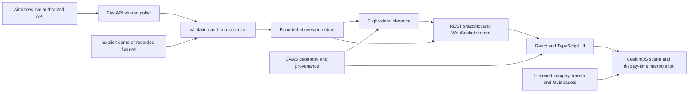

# Singapore Changi Airport Real-Time 3D Digital Twin

**Master project goal and requirements — evolution from Changi Live 3D v0.1**  
**Prepared:** 19 November 2026, Asia/Singapore  
**Status:** Specification for implementation; requirements and targets below are not claims of delivered functionality.  
**Airport:** Singapore Changi, SIN / WSSS  
**Selected stack:** React, TypeScript, Vite, CesiumJS, Python FastAPI, Airplanes.live, WebSockets.

## 1. Vision and definition of success

Build a runnable browser application that lets a person explore a geographically grounded 3D Changi Airport and watch aircraft approaching, landing, taking off, and departing using available near-real-time observations. Users can select an aircraft, follow it with the camera, inspect its recent track and estimated flight phase, and switch between day and night presentation.

The experience should be visually convincing without implying more certainty than the data supports. A smooth animation is not proof of a measured flight path. Every displayed aircraft must expose the origin, timing, and uncertainty of its position and flight-state estimate.

“Digital twin” here means a geospatial airport representation linked to an external aircraft feed. It does not mean an authoritative operational replica, a complete ground-surveillance system, or an air-traffic-control tool. The product is for exploration, education, and research; it must say it is not for navigation or operational decisions.

Success means a new developer can unpack the project, follow its setup instructions, run both services, inspect real observations when authorized provider access is available, and reproduce the acceptance tests offline. A disconnected feed must produce an honest unavailable state, not convincing invented traffic.

## 2. v0.1 baseline and evidence boundary

The referenced conversation, **Research Changi 3D Visualization**, reports the following prototype:

| Area | Reported v0.1 behavior | Required next action |
|---|---|---|
| Frontend | React/TypeScript/CesiumJS globe, runway overlays, aircraft markers | Inspect source; install dependencies and verify production build |
| Backend | FastAPI, Airplanes.live geographic queries, WebSocket delivery | Verify response schema, timestamp units, request policy, and end-to-end operation |
| Geometry | CAAS AIP-derived runway endpoints | Audit actual coordinates and source edition; verify thresholds versus pavement ends |
| Interaction | Follow camera and night lighting toggle | Verify behavior and recover gracefully when aircraft or assets disappear |
| Flight phases | Basic descent/climb classification | Replace or extend with evidence-based, uncertainty-aware state inference |
| Reliability | Feed errors, reconnect, last-received indicator | Verify failure cases; add position-age tracking and separate transport/feed status |
| Realism | Aircraft markers; no modeled terminals or taxiways | Add licensed aircraft meshes and sourced airport structures |
| Validation | Python compilation reportedly passed | Frontend installation timed out; live end-to-end behavior was not verified |

These are statements from the earlier chat, not an independent source-code audit. The earlier archive was linked as `sandbox:/mnt/data/changi-live-3d.zip`; that reference is not a usable local project path in this workspace. No matching archive was found in the current workspace, Documents/Codex, or Downloads during preparation. Therefore this deliverable is a standalone `goal.md`, and no updated application ZIP is claimed.

When the archive becomes available, inspect it before making changes, place this file beside the project README in its actual root, and map these requirements onto its existing files. Preserve useful code; do not rebuild solely to match the illustrative directory structure below.

## 3. Scope, priorities, and decisions

### 3.1 Required release scope

- A realistic airport viewer with sourced runway geometry, taxiways, terminal footprints and recognizable exterior building masses, terrain/base-map context, and runway lighting visualization.
- Near-real-time aircraft ingestion from **Airplanes.live**, subject to verified access and usage terms.
- Geolocated GLB/glTF aircraft models, with a generic model and marker fallback.
- Aircraft selection, search by callsign/identifier, detail panel, recent trails, airport overview, runway views, and follow mode.
- Landing and takeoff visualization driven by observations and explicitly labeled inference.
- Manual day/night mode and optional time-of-day lighting using an explicit scene clock.
- Feed health, per-aircraft position age, clear observed/estimated/simulated labels, and useful error recovery.
- Reproducible local setup, documented configuration, tests, production build, and downloadable source project.

### 3.2 Conditional or later scope

- Taxiing and rollout detail depend on demonstrated ground-position coverage. Do not fill coverage gaps with invented taxi routes.
- Local fixture playback and deterministic demo scenarios are required for testing. A user-facing historical replay service, long-term recordings, analytics, and PostgreSQL/PostGIS are later work.
- Additional providers, automated NOTAM ingestion, airline liveries, detailed interiors, moving service vehicles, VR, and mobile performance optimization are optional follow-ups.
- Redis and multi-instance infrastructure are unnecessary for the first release unless deployment requirements justify them.

### 3.3 Decisions and implementation defaults

The user selected the realistic viewer, Airplanes.live, the core stack, and landing/takeoff/follow/night features. The numeric defaults in this document are proposed engineering baselines, not provider guarantees or measured Changi performance. Keep them configurable and document any evidence-based changes.

Use one shared backend poller and an in-memory bounded track store initially. This minimizes complexity and prevents each browser from multiplying upstream requests. Direct browser polling would complicate access control and consistency. A distributed ingest service is a later scaling option. Provider substitution requires an explicit project decision; do not silently switch sources.

## 4. Functional requirements

| ID | Requirement |
|---|---|
| FR-01 | Load a Changi overview with visible airport geometry and an understandable loading/error state. |
| FR-02 | Ingest the authorized Airplanes.live geographic feed, normalize it, and distribute one coherent snapshot stream to all clients. |
| FR-03 | Keep stable aircraft identities across updates; tolerate blank callsigns and changing metadata. Do not use callsign as the primary key. |
| FR-04 | Render aircraft in geographic position with appropriate scale and orientation, using fallbacks when metadata or assets are missing. |
| FR-05 | Let users select, search, follow, and unfollow an aircraft; support overview and named runway camera presets. |
| FR-06 | Display identifier, callsign when supplied, reported altitude and its reference, speed, position age, source, display method, and inferred phase. Missing data reads “Unknown,” not zero. |
| FR-07 | Show a bounded recent trail with observation points and distinguish interpolated/predicted portions. Break trails across invalid or excessive gaps. |
| FR-08 | Infer approach/departure and, when evidence permits, runway-related phases. Display reasons, confidence category, and candidate runway rather than claiming confirmed events. |
| FR-09 | Provide day/night controls without changing aircraft timestamps or implying the displayed lighting is an observed airport condition. |
| FR-10 | Display feed connectivity, upstream status, last successful response, newest position age, and stale/lost aircraft independently. |
| FR-11 | Recover from network interruptions and server restarts without duplicate aircraft, unbounded retries, or silent time resets. |
| FR-12 | Support explicitly selected offline demo/fixture mode with a persistent “SIMULATED” or “RECORDED — NOT LIVE” banner. Never enter demo automatically on live failure. |
| FR-13 | Expose airport geometry edition, feature provenance, attribution, and the distinction between published infrastructure and current operational availability. |
| FR-14 | Supply source, lockfiles, setup instructions, configuration examples, source/asset licenses, and reproducible verification commands. |

## 5. Architecture and component responsibilities



Demo/recorded input uses the same contract for testing but runs in a separate mode and identity namespace. It cannot inject records into the live store.

### 5.1 Backend

- Python FastAPI owns provider access, request scheduling, validation, timestamp normalization, recent observation history, and authoritative application flight-state inference.
- Start and stop the shared poller with application lifecycle management. First release uses one application worker; multiple workers must not each start an upstream poller. Scaling requires a separate ingest process/shared broker or equivalent coordination.
- Isolate the provider in an adapter so schema changes and future approved providers do not affect scene code.
- Send normalized raw observations and inferred state; the browser derives display positions without altering stored observations.
- Bound history to five minutes per aircraft and 1,000 tracked identities by default. Expire lost tracks and expose capacity eviction; never silently imply complete coverage.
- Use structured logs and counters for upstream requests, status codes, latency, invalid records, fresh/stale tracks, clients, dropped updates, and reconnects. Do not log credentials.

### 5.2 Frontend

- React/TypeScript owns controls, accessible status/detail panels, mode selection, and application state. CesiumJS owns terrain, geometry, entities, scene time, camera, and frame rendering.
- Keep per-frame movement out of React component rerenders. Update stable Cesium entities, bound trail lengths, reuse model assets, and clean up viewers/listeners on unmount.
- Use time-indexed position samples with explicit interpolation and extrapolation settings; do not rely on library defaults for freshness enforcement. Cesium provides this mechanism through [SampledPositionProperty](https://cesium.com/learn/cesiumjs/ref-doc/SampledPositionProperty.html).
- Show a clear WebGL/GPU-unavailable message and retain a readable aircraft/status list when the 3D scene cannot run.

### 5.3 Proposed interfaces

| Interface | Contract |
|---|---|
| `GET /api/health` | Process liveness, schema/application version; successful response does not imply healthy live data |
| `GET /api/status` | Feed mode, upstream access/error state, last attempt/success, retry time, geometry edition, counts and timing quality |
| `GET /api/aircraft` | Current full normalized snapshot with server time, stream epoch, sequence and mode |
| `GET /api/airport` | Versioned geometry manifest, provenance, source dates, operational-status caveats |
| `WS /ws/aircraft` | Full snapshot on connect, then bounded full snapshots plus independent heartbeat/status messages |

Start with full snapshots for a modest airport-area dataset. Add deltas only after measurement, with explicit removal and resynchronization semantics. A new stream epoch identifies a backend restart; sequence numbers are monotonic within an epoch. Reconnect requests a fresh full snapshot. The client rejects old-epoch and out-of-order messages. A slow client receives the latest snapshot rather than an accumulating backlog.

FastAPI documents [WebSocket support and disconnection handling](https://fastapi.tiangolo.com/advanced/websockets/); this application must add its own heartbeat, reconnect, and stream-consistency rules.

### 5.4 Suggested project organization

```text
changi-live-3d/
  goal.md
  README.md
  .env.example
  frontend/                 React, TypeScript, CesiumJS and UI tests
  backend/                  FastAPI, provider adapter, contracts, inference, tests
  data/airport/             Versioned geometry and provenance manifest
  assets/                   Redistributable models, textures and license records
  tests/fixtures/           Synthetic or permitted recorded scenarios with labels
  docs/superpowers/specs/   Approved feature designs
  docs/superpowers/plans/   Executable milestone plans
  docs/evidence/            Verification results, coverage and benchmark reports
```

## 6. Airplanes.live integration and data contract

### 6.1 Access and coverage gate

The earlier prototype used this geographic-query pattern:

```text
https://api.airplanes.live/v2/point/1.3644/103.9915/25
```

Treat the coordinate as a provisional query centre and the radius as 25 nautical miles, subject to confirmation of the provider contract. It is not a source for runway geometry. The official [API documentation](https://airplanes.live/api-docs/) returned HTTP 403 to the research tool during this document's preparation; the sample API endpoint could not be accessed through that tool. This does not establish whether a properly authorized deployment can use it.

Before enabling live mode, verify the current endpoint, authentication/access process, rate limits, geographic coverage, permitted display/redistribution, attribution, retention, and timestamp/field semantics using the provider's current documentation or direct authorization. Save dated evidence. Do not assume anonymous, free, unlimited, or guaranteed access from v0.1.

Proposed poll interval: 10 seconds, adjusted to satisfy the verified provider policy. Use a fixed allowlisted upstream host, request timeout of five seconds, and no overlapping requests. Credentials remain on the backend. Provider latency, data collection latency, poll delay, and display buffer all contribute to visible lag; report them separately where measurable.

Conduct permitted coverage sampling across at least three 30-minute windows at different Singapore times, including an evening window. Record position-age distributions, sample intervals, coverage near each relevant runway, observed ground reports, missing fields, errors, and outages. Sampling does not prove every aircraft is visible. If access is unavailable, complete fixture-based engineering but mark the live-release gate unmet.

### 6.2 Normalized record

Each normalized aircraft record must include these concepts; the implementation plan fixes exact schema/types and nullability:

| Group | Fields / meaning |
|---|---|
| Identity | Provider, provider aircraft identifier, track/session identifier, optional callsign/registration/type; preserve non-ICAO identifier forms |
| Position | Latitude/longitude in decimal degrees, nullable geometric altitude, nullable barometric altitude, original altitude values/units, nullable ground flag |
| Motion | Nullable ground speed, ground track, true heading, vertical rate; preserve each field's source and age when available |
| Time | Provider response time, derived/source position time, server receipt time, latest message time when available, timestamp-quality flag |
| Provenance | Live/recorded/simulated mode, provider source category such as ADS-B/MLAT when supplied, quality/integrity indicators when supplied |
| Inference | Estimated flight phase, candidate runway or null, confidence category, reasons, evidence times, rule/version identifier |
| Transport | Schema version and snapshot sequence/epoch; all event times represented consistently in UTC |

Use metres and metres/second internally where practical, with explicit conversions: 1 foot = 0.3048 metres; 1 knot = 0.514444… metres/second; feet/minute × 0.00508 = metres/second. Preserve original measurements for inspection; aviation display may use feet, knots, and feet/minute. Never reinterpret an altitude string such as `ground` as a numeric altitude of zero.

Confirm the provider's exact time units before deriving `position_time = provider_response_time - position_age`. Do not assume a field named `now` is in seconds or milliseconds without verification. Message age is not position age. Refreshing a cached response or receiving a heartbeat must not refresh a position timestamp.

Validate coordinate ranges, finite numeric values, timestamp plausibility, schema shape, and implausible jumps. Drop or quarantine invalid samples with reasons. Preserve legitimate zero values and unknown fields appropriately. Reject late/duplicate positions from advancing live inference; historical insertion may enrich a trail but must not rewind the current aircraft state.

If position timing is missing or unreliable, mark freshness **Unknown**, display receipt time separately, and prohibit confident live-event inference. Do not replace missing position time with receipt time and call it observed.

## 7. Authoritative airport geometry and visual realism

### 7.1 Sources and provenance

Use the [CAAS Aeronautical Information Services](https://www.caas.gov.sg/industry/airspace-management-and-aerial-activities/aeronautical-information-services/) and [AIM-SG AIP index](https://aim-sg.caas.gov.sg/aip/) to select the effective WSSS AD 2 information and relevant aerodrome charts. Review applicable supplements and [NOTAM information](https://aim-sg.caas.gov.sg/notam-list/) before making time-sensitive operational claims.

A [WSSS AD 2 edition surfaced during research](https://aim-sg.caas.gov.sg/aim-content/uploads/aip/17-SEP-2026/AIP/2026-09-03-000000/html/eAIP/SG-AD-2-WSSS-en-GB.html) provides a starting reference, not a verified current operational baseline. Do not hard-code the prior chat's statement about civil availability of runway 02R/20L. Physical presence, published runway characteristics, and current availability are separate properties.

Create a source manifest for each feature class containing publisher, URL/chart identifier, publication and effective dates, retrieval date, coordinate/vertical reference, extraction method, source precision, license/reuse status, reviewer, and file checksum. Future-effective infrastructure is a separately labeled planned layer. Unknown operational status stays unknown.

Use OpenStreetMap or other appropriately licensed datasets for supplemental buildings, roads, and context. These do not override aeronautical runway coordinates. Provide the required attribution and document derived-data obligations; see [OpenStreetMap copyright and license](https://www.openstreetmap.org/copyright). Verify imagery, terrain, model, texture, and CAAS material reuse separately; public accessibility alone is not redistribution permission.

### 7.2 Geometry requirements

- Represent the 02L/20R, 02C/20C, and 02R/20L runway pairs as sourced features; verify their dimensions, thresholds, displaced thresholds, pavement ends, elevations, and designations against the chosen edition.
- Store WGS84 coordinates in versioned GeoJSON or equivalent; document longitude/latitude order and all transformations. Calculate true geodesic bearing from endpoints for geometry; runway numbers and magnetic bearings are not substitutes.
- Distinguish landing threshold from physical pavement end. Do not use a displaced threshold to shorten the modeled pavement incorrectly.
- Use sourced taxiway centre lines/polygons and terminal footprints. If only chart-derived or approximate geometry is available, label that layer accordingly and record uncertainty.
- Create exterior terminal masses with sourced or clearly estimated heights. Mark decorative facades, simplified roofs, and proposed construction as visual approximations.
- Use a consistent height model. Orthometric/MSL height, ellipsoid height, terrain elevation, and barometric altitude are different. Apply a documented geoid transformation where appropriate; if that conversion is unavailable, expose the approximation and do not infer touchdown from visual ground contact.
- Retain raw aircraft altitude even when a model requires a visual ground offset. Clamping a confirmed ground report to the airport surface is a display adjustment, not a new observed altitude.
- Reproduce documented lighting layout where feasible. Artistic glow and manual night mode must not imply knowledge of real-time runway lighting state.

### 7.3 Geometry verification

Compare imported thresholds with independent extraction of the same authoritative coordinates: proposed numerical tolerance ≤2 metres, subject to source precision. Compare derived lengths within 5 metres and true bearings within 0.1 degrees, or document source rounding/displaced-threshold effects. These are import-consistency checks, not a claim of survey accuracy. Visually inspect all runway ends, taxiway joins, building placement, vertical alignment, and day/night scenes. Require provenance for every production geometry layer.

## 8. Observed, interpolated, predicted, simulated, and recorded data

Display method and data origin are separate attributes. For example, a recorded observation can be interpolated during replay; interpolation does not make it live.

| Label | Meaning | Required presentation |
|---|---|---|
| Observed | A provider-reported position at its source timestamp; it may itself be MLAT-derived or uncertain | Source/time/age visible; no claim of exact physical truth |
| Interpolated | A display position between two valid time-bracketing observations | “Interpolated,” render time, bracket times; raw observations remain inspectable |
| Predicted | A short extrapolation beyond the latest observation | “Predicted,” prediction duration, visibly distinct trail/style |
| Simulated | A synthetic scenario or movement with no corresponding live observation | Persistent scene banner, separate identifiers, never included in live counts |
| Recorded | Historical observations played on a replay clock | Persistent “Recorded — not live” banner and original timestamps |
| Last known / stale | A held position whose sample is no longer current | Last actual position time and age; no continuing inferred landing animation |

Default rendering policy:

1. Use a ten-second display buffer for interpolation. Show the buffer and actual rendered timestamp. Dynamic changes to buffering must be visible and recorded.
2. Interpolate only within valid brackets no more than 20 seconds apart. Do not connect discontinuities, teleportations, identity changes, or long gaps.
3. Default extrapolation is **off**. If enabled, allow no more than five seconds beyond the last observation and never beyond the freshness limit. Prediction never supplies evidence for phase inference.
4. After any prediction allowance expires, return/hold at the last actual observation with an explicit last-known label; do not leave a predicted endpoint labeled observed. Avoid smoothing that conceals the correction.
5. Heading derived from ground track is a display estimate, especially on the ground or in wind. Mark computed pitch/bank and generic model type as estimates; do not infer actual attitude from a position alone.
6. Never snap an airborne track onto a runway or taxiway to make it look plausible. Any optional alignment display must preserve the observation, show its offset, and remain explicitly estimated.
7. No fabricated landing, flare, touchdown, wheel rotation, takeoff roll, taxi route, destination, or flight schedule may be presented as measured. Decorative animations must remain labeled and must not create flight events.

## 9. Flight-state inference

All flight phases are **inferred**, separate from position provenance. Implement a deterministic, versioned state machine before considering machine learning. No AI model is required to meet this project's scope.

```text
UNKNOWN / AIRBORNE
  -> APPROACH -> FINAL_APPROACH -> LANDING_CANDIDATE -> ROLLOUT -> TAXI
GROUND / TAXI
  -> RUNWAY_ALIGNED -> TAKEOFF_ROLL -> AIRBORNE_CLIMB -> DEPARTING
FINAL_APPROACH or LANDING_CANDIDATE -> GO_AROUND_CANDIDATE -> AIRBORNE_CLIMB
Any state -> UNKNOWN when evidence is missing, contradictory, or stale
```

These are permitted sequences, not mandatory scripts. A newly detected aircraft may start in an airborne state. Missing phases must remain missing.

### 9.1 Evidence and proposed initial rules

- Use accepted, time-ordered observations only: runway-relative position, ground track, speed trend, vertical trend, ground flags, altitude quality, and continuity. Repeated copies of one sample do not count as multiple observations.
- Require at least three distinct valid samples spanning at least ten seconds for trend-based transitions. Two consecutive qualifying evaluations provide hysteresis; reset evidence across gaps over 20 seconds. These defaults require calibration against measured update intervals.
- Initial final-approach candidate: within 8 nautical miles upstream of a runway threshold, ≤300 metres cross-track, course within 15 degrees of the runway's landing direction, and descent or independently credible low-altitude evidence. These are visualization heuristics, not aviation procedure definitions.
- If adjacent runways remain plausible, retain multiple candidates or no assignment. Confidence must fall when altitude, track, or ground status is missing.
- Landing candidate requires a continuous approach sequence followed by a credible airborne-to-ground transition near the runway and subsequent deceleration evidence. Report a time interval between observations, never an exact confirmed touchdown time.
- Rollout requires valid ground observations within/near the sourced runway polygon with heading continuity. Taxi classification requires repeated moving ground observations away from runway-roll evidence. Do not infer taxi solely from low altitude.
- Runway alignment requires fresh ground position within the runway corridor and compatible track when moving. A single low-speed heading is insufficient.
- Takeoff-roll candidate requires sustained acceleration along the runway from fresh ground observations; distinguish it from high-speed taxi with subsequent evidence. Airborne climb requires a ground-to-air transition plus sustained climb evidence. If ground coverage is absent, report “Climbing — departure candidate,” not an observed takeoff.
- Go-around candidate requires prior approach evidence followed by sustained climb without reliable landing evidence. Missing samples alone cannot create a go-around.
- On stale input, suspend transitions and show unknown/current state unavailable. Keep the previous estimate only as dated historical information.

Use `low`, `medium`, or `high` heuristic confidence with human-readable reasons, not fabricated probabilities. High confidence requires all required evidence and continuity for that rule. Publish thresholds in configuration, explain revisions, and evaluate false positives before using more assertive wording.

### 9.2 Required validation scenarios

Cover both runway directions; complete arrival and departure; approach without touchdown coverage; first detection already airborne; go-around; nearby overflight; parallel-runway ambiguity; taxi near a runway; discontinuity; missing/contradictory ground flag; unknown altitude reference; low-speed heading noise; stale and out-of-order samples; identical timestamps; identifier/callsign change. Synthetic fixtures test rule correctness; they do not validate real-world classification accuracy. Report a confusion matrix and sample counts on permitted independently reviewed real tracks when available, including an explicit unknown class.

## 10. Freshness, error handling, and recovery

### 10.1 Separate clocks and freshness states

Store UTC internally and show Singapore time with timezone labels where useful. Distinguish server receipt time, provider response time, position time, and display/replay time. Estimate server/client clock offset; flag implausible future samples instead of letting negative age appear fresh. In live mode, age continues increasing locally during disconnection or a paused display.

**Clock policy by mode:** Live freshness and inference eligibility use current wall-clock time against the original position time. Recorded playback and simulation use an explicit scenario clock for sample eligibility, gap handling, inference, and track expiry; historical timestamps must not make an entire replay immediately expire. Retain original recorded timestamps and show the scenario time plus a persistent non-live banner. Scenario-relative freshness must be labeled as such and must never produce a live/fresh-feed badge. Real-world age, when shown for recordings, is separate from scenario age. Pausing freezes scenario time, motion, inference, and scenario-age expiry while transport health continues on wall time. Resuming continues from the paused scenario time. Seeking or restarting clears inference/history and rebuilds it from the scenario's preceding observations. Synthetic fixtures declare their scenario epoch explicitly. Inject this mode-specific clock into the shared inference pipeline rather than rewriting observation timestamps to make them appear recent.

Proposed per-aircraft freshness based on **wall-clock age of the last actual position**, independent of display buffering:

| State | Position age | Behavior |
|---|---|---|
| Fresh | 0–20 seconds inclusive | Eligible for normal rendering and inference if evidence is otherwise valid |
| Delayed | >20–60 seconds | Show warning and last-known position; no new phase transitions |
| Stale | >60–120 seconds | Fade/freeze, label stale, exclude from current-event counts |
| Lost | >120 seconds | Remove from active scene/list; retain a selected-aircraft “Track lost” notice and bounded history |
| Unknown | No trustworthy position time | No fresh badge, no confident live inference; explain timing uncertainty |

Track transport state and upstream feed state separately. Proposed feed states: `connecting`, `healthy`, `degraded`, `unavailable`, and explicit `demo`/`recorded` modes. A validated successful poll within 30 seconds and no current failure can be healthy; an error or >30-second gap is degraded; no successful poll for >60 seconds is unavailable. A valid empty response is “No aircraft reported,” not a broken feed. Old positions returned by a healthy API remain old.

Use a ten-second WebSocket heartbeat and consider transport disconnected after 30 seconds without any server message. Reconnecting the socket never resets aircraft ages.

### 10.2 Failure behavior

| Failure | Required handling |
|---|---|
| Upstream timeout, DNS, or 5xx | Keep bounded last-known data, show degraded state, retry with exponential backoff and jitter, capped at 60 seconds |
| HTTP 429 | Honor `Retry-After`; never retry faster than permitted; show rate-limit status |
| HTTP 401/403 | Explain access/configuration failure; pause rapid automatic retries until configuration changes or explicit retry |
| Invalid payload/schema | Reject invalid data, keep previous timestamps, log diagnostics; do not report successful live refresh |
| Some invalid aircraft | Accept valid records with partial-data warning and invalid count; do not drop the entire feed unnecessarily |
| WebSocket closure/server restart | Reconnect with jittered backoff of 1–30 seconds, acquire full snapshot, reconcile epoch and identities |
| Empty response/disappearing aircraft | Distinguish no report from confirmed departure/landing; age missing tracks out normally |
| Missing model/texture | Use generic model or marker and disclose degraded visual detail |
| Imagery/terrain/token failure | Keep sourced airport geometry and status visible with a simple background/ellipsoid fallback; explain degraded height accuracy |
| Browser hidden/resumed | Recalculate age immediately and resynchronize; do not animate queued obsolete movements |
| Backend overload/slow client | Bound queues and keep latest snapshot; record dropped updates and preserve health responsiveness |

No error path may silently activate synthetic traffic or mark cached positions as newly observed.

## 11. Nonfunctional requirements

All performance values are targets to verify on a recorded reference machine, browser, dataset, viewport, and network condition.

| ID | Target / constraint |
|---|---|
| NFR-01 Performance | At least 30 FPS at 1920×1080 for 100 visible aircraft with five-minute bounded trails on a declared reference laptop; target 60 FPS where feasible. Measure a five-minute run after warm-up. |
| NFR-02 Application latency | p95 ≤2 seconds from backend receipt of a valid response to client receipt under the reference load; report display buffering and upstream age separately. |
| NFR-03 Capacity | Support ten simultaneous viewers in the initial single-worker deployment without increasing upstream poll frequency. |
| NFR-04 Startup | Usable geometry/status within ten seconds with warm asset cache on the reference network; show progressive loading immediately and report cold-cache timing separately. |
| NFR-05 Reliability | Two-hour scenario soak with injected outages, reconnects, and identity churn; no crashes, duplicate pollers, or unbounded growth. After warm-up, memory plateau must remain within 20% over the final hour under a fixed-size workload. |
| NFR-06 Accessibility | Keyboard-operable controls, visible focus, text/icons alongside status colors, reduced-motion support for camera transitions, readable details independent of the 3D canvas. |
| NFR-07 Security | Backend-only provider secrets; restricted CORS and WebSocket origin checks; HTTPS/WSS in hosted deployments; escaped provider text; bounded payloads and retries; no arbitrary upstream URL proxy. Public browser map tokens must be scoped appropriately. |
| NFR-08 Reproducibility | Pin supported runtime versions and dependencies after inspecting v0.1; provide lockfiles, example environment configuration, and clean-start instructions. Do not blindly retain obsolete runtime minima. |
| NFR-09 Maintainability | Typed contracts, isolated provider and geometry adapters, configurable thresholds, pure inference functions where practical, and versioned schema/geometry/inference rules. |
| NFR-10 Data governance | Document source permissions, retention and attribution; no unapproved archival or redistribution of live feed data. Fixture provenance is explicit. |
| NFR-11 Compatibility | Verify current desktop Chrome and Edge; run a Safari smoke test and document limitations. Responsive controls are required; mobile 3D performance is best-effort in the first release. |
| NFR-12 Observability | Health/status endpoints and structured logs distinguish process health, provider access, data freshness, geometry edition, and current display mode. |

## 12. Milestones and exit criteria

Each milestone produces runnable or reviewable evidence. Do not equate a completed screenshot or a successful Python compilation with a working application.

| Milestone | Deliverables | Exit criteria / dependencies |
|---|---|---|
| M0 — Recover and audit v0.1 | Source inventory, baseline build report, gap list, geometry/source audit, dependency/license inventory | Existing archive inspected if available; reported versus verified behavior separated. If absent, record that limitation before any later reconstruction. |
| M1 — Validate live data | Provider contract, access/usage evidence, normalizer, timestamp tests, coverage report, status endpoint | Authorized retrieval works, fields/times are verified, coverage limits documented. If blocked, fixture work continues but live readiness stays blocked. |
| M2 — Verified airport scene | Versioned runway/taxiway/terminal geometry, source manifest, terrain fallback, camera presets | Geometry consistency checks pass; layer provenance and approximations visible; real operational status not assumed. Can proceed alongside M1 after M0. |
| M3 — Honest live viewer | GLB models/fallbacks, shared stream, selection/follow, trails, provenance badges, freshness and reconnect | Live/fixture observations render with correct time semantics; no fabricated freshness or hidden predictions. Depends on M1 contract and M2. |
| M4 — Flight phases and night | Versioned inference, candidate runway logic, day/night scenes, scenario fixtures and evaluation report | Required scenarios pass; uncertainty is shown; ground-dependent claims restricted by M1 coverage. |
| M5 — Release and handoff | Production build, test evidence, performance/soak report, setup guide, assets/licenses, distributable ZIP | All required acceptance criteria pass; unmet live access or coverage gates are prominently recorded and prevent a “fully live” release claim. |

Delivery dates follow M0/M1 findings. Do not convert these milestones into promised calendar dates before access, geometry extraction, and asset availability are known.

## 13. Acceptance criteria and evidence

| ID | Scenario and measurable pass condition | Evidence / owner milestone |
|---|---|---|
| AC-01 | On a clean checkout, documented backend startup, frontend typecheck, tests, and production build succeed using pinned dependencies | Command logs and runtime versions; M0/M5 |
| AC-02 | Authorized Airplanes.live request returns validated data; sampled provider positions and timestamps match normalized values within documented conversion precision | Redacted response/contract evidence and comparison test; M1 |
| AC-03 | Every runway threshold has authoritative source metadata; numeric consistency meets §7.3 tolerances or a reviewed source-precision exception | Geometry report and overview/end screenshots; M2 |
| AC-04 | Selected aircraft exposes original observation time, age, altitude reference, source, and display method; no missing value becomes a fabricated zero | Contract/UI scenario tests; M3 |
| AC-05 | Two synthetic observations at t=0 and t=10 yield a labeled interpolated midpoint at display t=5; a 21-second gap produces no interpolation under defaults | Deterministic interpolation tests; M3 |
| AC-06 | Extrapolation is disabled by default; when enabled it stops at five seconds and cannot advance flight-state evidence | Clock-controlled prediction tests; M3 |
| AC-07 | At ages 20/21/60/61/120/121 seconds, states are fresh/delayed/delayed/stale/stale/lost; cached responses and heartbeats never reset age | Fake-clock tests including disconnection; M3 |
| AC-08 | Timeout, invalid payload, 401/403, 429, empty response, and WebSocket restart each produce the specified state and recovery without fake traffic | Failure-injection report; M1/M3 |
| AC-09 | Landing/takeoff fixtures produce inferred candidate labels with evidence; missing ground coverage, overflight, parallel-runway ambiguity, and stale data do not become confirmed runway events | State-machine suite and reviewed-track evaluation limitations; M4 |
| AC-10 | Follow camera tracks the selected aircraft, can be exited by keyboard/control, and gracefully stops on track loss; night mode preserves timestamp and source labels | Browser scenario recording/screenshots; M4 |
| AC-11 | Live, simulated, and recorded modes have distinct banners/identities; switching modes clears incompatible tracks and cannot contaminate live counts. A historical recording remains eligible by scenario age while retaining original timestamps; pause freezes scenario expiry, and seek rebuilds state without future-sample leakage | Mode-switch and scenario-clock tests; M3/M5 |
| AC-12 | Models and terrain failing to load leave functional status/details and a usable visual fallback; unknown altitude reference cannot create false touchdown | Asset/height failure tests; M2/M3 |
| AC-13 | 100-aircraft performance and ten-viewer tests meet NFR-01–03; two-hour soak meets NFR-05 | Hardware/configuration, timing distributions, memory and poll-count logs; M5 |
| AC-14 | No provider credentials in browser bundle or ZIP; required attributions and license records present; origin checks and input escaping verified | Release inspection and targeted security tests; M5 |
| AC-15 | ZIP contains `goal.md` at application root, README, frontend/backend source, lockfiles, permitted assets/fixtures and configuration example; excludes credentials, environments and dependency caches | Archive-content check and clean unpack/run; M5 |

Automated tests use fixed clocks and deterministic fixtures. External API smoke checks run separately and record time, environment, permission, and outcome. Tests skipped because a provider is inaccessible must be reported as skipped/unverified, not passed.

## 14. Risks and mitigations

| Risk | Impact | Mitigation / decision gate |
|---|---|---|
| Provider access, terms, or rate limits differ from v0.1 | Live integration may be unavailable or unsuitable | Verify in M1; keep backend adapter; show honest unavailable state; seek approval before changing provider |
| Sparse ADS-B/MLAT ground coverage | Convincing taxi/landing sequences cannot be reliably observed | Measure coverage; restrict phases and show unknown; demo is an explicit separate mode |
| Timestamp/altitude reference mistakes | False freshness, aircraft below terrain, false touchdown | Preserve originals, verify schema/units, test clocks/conversions, document vertical datum |
| Outdated AIP or construction data | Incorrect airport or runway-status claims | Version by effective date, review supplements/status, separate planned and operational layers |
| Parallel runways, noisy samples, low-speed headings | Wrong runway or flight phase | Corridor ambiguity, hysteresis, quality checks, unknown class and evidence explanations |
| Attractive smoothing hides uncertainty | Users mistake predicted motion for observation | Persistent source/display labels; bounded interpolation/prediction; preserve raw samples |
| Model/imagery licenses or tokens | Distribution problems, unexpected cost, broken visuals | License inventory, permitted local assets, scoped tokens, fallbacks and documented deployment costs |
| GPU and memory pressure | Poor interaction or crashes | Level of detail, bounded trails/history, stable entities, quality controls and measured budgets |
| Multiple server workers duplicate polling | Rate-limit violations and inconsistent state | Single-worker first release; coordinated ingest before scaling |
| Prototype code or archive unavailable | Cannot verify or preserve exact baseline | Make M0 evidence explicit; use this spec as a handoff, not proof the application exists |

## 15. Superpowers development workflow

This file is the master goal/specification. It is not an instruction to skip code inspection, nor a completed task-by-task implementation plan. The present deliverable is documentation; later product implementation follows the workflow below within the user's authorized scope.

1. **Inspect context and establish evidence.** Read `goal.md`, repository guidance, the actual v0.1 files, and available test/build results. Record which baseline claims have been reproduced. Verify current provider and geometry sources before coding against them.
2. **Use `superpowers:brainstorming` for material unresolved design choices.** Build on the selected stack and scope rather than re-asking settled questions. Surface only choices that affect product behavior, cost, access, or data honesty. Mark engineering defaults as proposals; obtain required design approval for new implementation scope.
3. **Write milestone plans with `superpowers:writing-plans`.** Store them under `docs/superpowers/plans/`. Map tasks to FR/NFR/AC IDs, actual files, shared schemas, exact interfaces, test cases, commands, dependencies, and expected results. Keep feature designs under `docs/superpowers/specs/` as useful; `goal.md` remains at root.
4. **Use appropriate isolation.** Follow `superpowers:using-git-worktrees` when isolation is needed; first detect an existing worktree and preserve user changes. Do not create redundant checkouts.
5. **Execute in small, verifiable increments.** Use `superpowers:executing-plans` for inline work. Use `superpowers:subagent-driven-development` only when that execution approach is authorized; give independent workers explicit file ownership and shared contracts.
6. **Test behavior before implementing risky logic.** Apply `superpowers:test-driven-development` to normalization, freshness, state transitions, reconnect, and mode separation: write a meaningful failing case, verify the failure, implement the smallest solution, rerun. Visual adjustments use targeted visual verification rather than tests that merely repeat implementation details.
7. **Diagnose failures systematically.** Use `superpowers:systematic-debugging` to establish a reproducible cause before patching. Keep provider outages distinct from application defects and preserve evidence of both.
8. **Review connected behavior.** Apply `superpowers:requesting-code-review` and `superpowers:receiving-code-review` where appropriate. Review data truthfulness, geometry/height handling, outage behavior, resource limits, security, and feature completeness, not just rendering screenshots.
9. **Verify before claiming completion.** Use `superpowers:verification-before-completion`; run current checks and inspect their results. Distinguish fixture success, successful build, and actual live-feed verification. Store concise dated evidence and unresolved limitations.
10. **Finish and package deliberately.** Follow `superpowers:finishing-a-development-branch` within the authorized integration scope. Review changes, update README/goal status, assemble a clean ZIP, verify its contents, and perform an unpack/start check. Deployment, publication, or provider changes are separate decisions when not already authorized.

Routine defaults can be resolved by the builder and documented. Escalate only decisions that materially change the agreed project, such as replacing Airplanes.live, adding paid infrastructure, reducing the geometry scope, or representing unobserved motion as a new explicitly separate simulation feature. Never resolve a missing-data problem by weakening provenance rules.

## 16. Definition of done and handoff checklist

- [ ] v0.1 source and build status audited, or its absence explicitly documented.
- [ ] Provider access, policy, timestamp semantics, and Changi coverage verified for the live release.
- [ ] Geometry and vertical reference documented, tested, versioned, and attributed.
- [ ] Aircraft models, selection, follow, trails, night mode, and visual fallbacks work.
- [ ] Observed/interpolated/predicted/simulated/recorded distinctions remain visible in all relevant UI states.
- [ ] Flight phases remain explainable estimates; missing evidence remains unknown.
- [ ] Freshness boundaries, outage behavior, reconnect, and mode isolation pass deterministic tests.
- [ ] Production build, browser checks, benchmark, soak, and release inspection have current evidence.
- [ ] README covers setup, ports, configuration, runtime versions, operating modes, attribution, troubleshooting, and known limitations.
- [ ] Source ZIP passes contents and clean-start checks, with `goal.md` at its root.
- [ ] Release notes separate delivered functionality, verified live behavior, conditional ground coverage, and deferred work.

**Final completion rule:** Do not describe this as a fully working live digital twin until the live access, geometry, data-integrity, and end-to-end acceptance gates are supported by evidence. A useful offline viewer or partially verified prototype may still be delivered, but its status must be stated accurately.
